<h1 align="center">Ashfaq Khan Rafin</h1>

<p align="center">
  <em>Computer Science × Economics × Political Science</em> &nbsp;·&nbsp; BRAC University &nbsp;·&nbsp; Dhaka, Bangladesh
</p>

<p align="center">
  <a href="https://ashfaqrafin.vercel.app">Portfolio</a> &nbsp;·&nbsp;
  <a href="https://twitter.com/ashfaqrafin">Twitter</a> &nbsp;·&nbsp;
  <a href="https://linkedin.com/in/ashfaqrafin">LinkedIn</a> &nbsp;·&nbsp;
  <a href="https://www.kaggle.com/ashfaqkhanrafin">Kaggle</a> &nbsp;·&nbsp;
  <a href="https://leetcode.com/ashfaqrafin">LeetCode</a> &nbsp;·&nbsp;
  <a href="https://codeforces.com/profile/ashfaqrafin">Codeforces</a>
</p>

<p align="center">
  
</p>

### about

I'm a senior studying computer science and economics, two fields that keep asking the same question from different ends: who gets what, and why. I don't just want to write better code; I want to code a more equitable world.

I believe in collective ownership of the means of production, and of the codebase. ☭

### toolbox

TypeScript &nbsp;·&nbsp; React &nbsp;·&nbsp; Next.js &nbsp;·&nbsp; Prisma &nbsp;·&nbsp; PostgreSQL &nbsp;·&nbsp; C++ &nbsp;·&nbsp; Rust &nbsp;·&nbsp; GO &nbsp;·&nbsp; Python &nbsp;·&nbsp; Bash &nbsp;·&nbsp; Neovim

### this week in code

<!--START_SECTION:waka-->

```txt
TypeScript    5 hrs 23 mins         ███████▓░░░░░░░░░░░░░░░░░   31.02 %
Other         2 hrs 32 mins         ███▓░░░░░░░░░░░░░░░░░░░░░   14.56 %
Markdown      2 hrs 19 mins         ███▒░░░░░░░░░░░░░░░░░░░░░   13.34 %
Bash          1 hr 47 mins          ██▓░░░░░░░░░░░░░░░░░░░░░░   10.28 %
JavaScript    46 mins               █░░░░░░░░░░░░░░░░░░░░░░░░   04.41 %
```

<!--END_SECTION:waka-->

<p align="center">
  <sub>from each according to their ability, to each according to their pull requests</sub>
</p>

<!--
#### Github Stats


[](https://github.com/anuraghazra/github-readme-stats) 

<a href="https://github.com/anuraghazra/github-readme-stats">
  
</a>
<a href="https://github.com/anuraghazra/convoychat">
  
</a>
▄︻デ══━一💥🇺🇸🇪🇺🇮🇱💥一━══テ︻▄. 
-->
